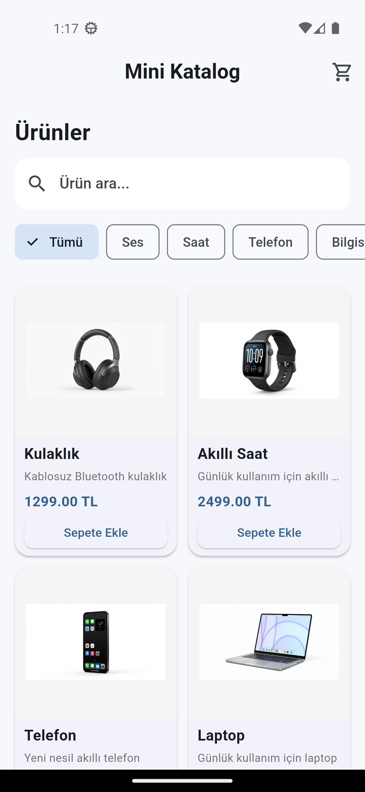
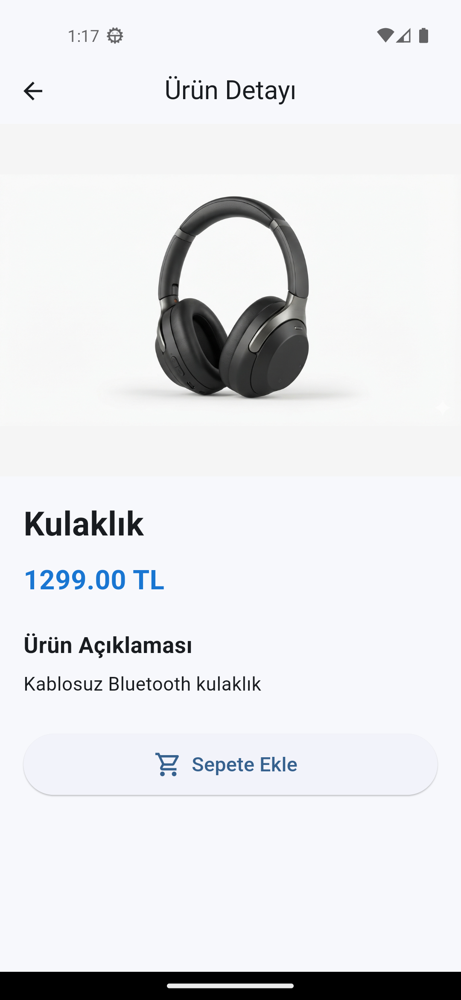
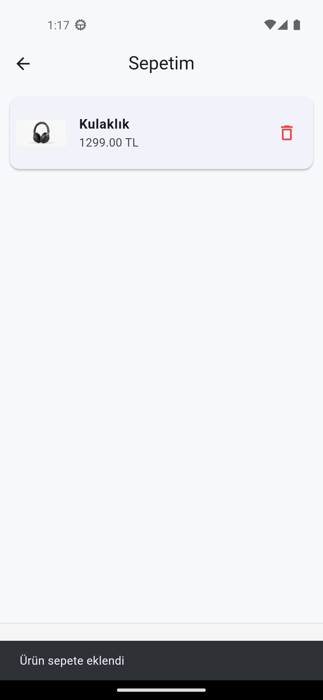

# Mini Katalog Uygulaması

Flutter kullanılarak geliştirilmiş basit bir mobil katalog uygulamasıdır.

## Proje Hakkında

Bu uygulamada kullanıcılar ürünleri görüntüleyebilir,
ürün arayabilir, kategorilere göre filtreleme yapabilir,
ürün detaylarını inceleyebilir ve ürünleri sepete ekleyebilir.

Ürün bilgileri JSON dosyasından alınmaktadır.

## Özellikler

- Ürün listeleme
- GridView ile ürün kartları
- Ürün arama
- Kategori filtreleme
- Ürün detay sayfası
- Ürünleri sepete ekleme
- Sepetten ürün silme
- Toplam fiyat hesaplama
- JSON üzerinden ürün verisi
- fromJson ve toJson kullanımı
- Navigator ile sayfa geçişleri
- Basit kullanıcı arayüzü

## Kullanılan Teknolojiler

- Flutter
- Dart
- Material Design
- JSON

## Flutter Sürümü

Flutter 3.24.0

## Proje Yapısı

```text
lib/
├── models/
│   └── product.dart
├── screens/
│   ├── home_screen.dart
│   ├── product_detail_screen.dart
│   └── cart_screen.dart
├── widgets/
│   └── product_card.dart
└── main.dart

assets/
├── images/
│   ├── kulaklik.png
│   ├── saat.png
│   ├── telefon.png
│   └── laptop.png
└── products.json

## Ekran Görüntüleri

### Ana Sayfa



### Ürün Detay



### Sepet

